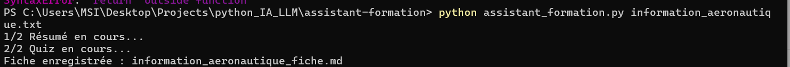
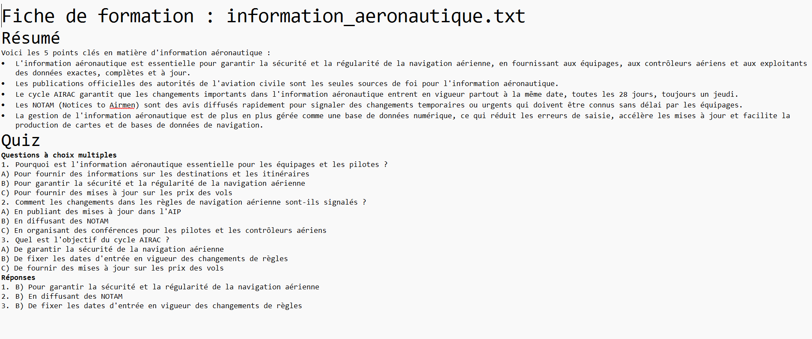

# Assistant de formation

Petit script Python qui lit un document texte et demande à un modèle de langage (LLM) d'en faire :

- un **résumé en 5 points** ;
- un **quiz de 3 questions** à choix multiples, avec les réponses regroupées à la fin.

Le résultat est enregistré dans un fichier, à côté du document.

Le modèle tourne **en local** sur l'ordinateur grâce à [Ollama](https://ollama.com) : aucun compte, aucune clé et aucune donnée envoyée sur Internet.

Projet personnel réalisé pour découvrir Python et l'utilisation des modèles de langage.

## Installation

1. Installer [Python](https://www.python.org/downloads/) (3.10 ou plus récent).
2. Installer [Ollama](https://ollama.com/download), puis télécharger le modèle :

   ```bash
   ollama pull llama3.2
   ```

3. Installer la bibliothèque Python d'Ollama :

   ```bash
   pip install -r requirements.txt
   ```

## Utilisation

```bash
python assistant_formation.py information_aeronautique.txt
```

Le script crée le fichier `information_aeronautique_fiche.md`, qui contient le résumé et le quiz.

Pour l'utiliser sur un autre document, remplacer `information_aeronautique.txt` par le chemin d'un fichier texte.

## Exemple

Le dépôt contient un document d'exemple, `information_aeronautique.txt` : un texte d'environ 730 mots qui présente l'organisation de l'information aéronautique (AIP, NOTAM, cycle AIRAC).

Exécution dans le terminal :



Fiche générée (résumé en 5 points et quiz de 3 questions) :



## Comment ça marche

1. `lire_document` ouvre le fichier et renvoie son texte.
2. `demander_au_modele` envoie au modèle une instruction (le *prompt*) suivie du document.
3. `resumer` et `generer_quiz` utilisent chacune une instruction différente.
4. `enregistrer` écrit la fiche de formation dans un fichier.

Les réglages se trouvent en haut du script : nom du modèle, nombre de points du résumé et nombre de questions.

## Limites

- Le script lit uniquement des fichiers texte (`.txt`, `.md`), pas les PDF ni les fichiers Word.
- Seuls les 6 000 premiers caractères d'un document long sont utilisés.
- La qualité du résumé et du quiz dépend du modèle : il faut toujours relire le résultat.
- Le document d'exemple est un texte pédagogique, pas une publication aéronautique officielle.

## Technologies

Python, Ollama (LLM local).
